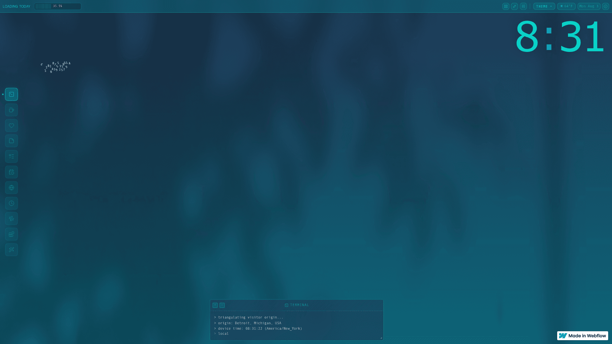

# DESIGN.md: Loading Today Sidebar Adaptation

## Source
- URL: https://loadingtoday.webflow.io/
- Capture date: 2026-08-03
- Evidence: Firecrawl branding and HTML capture, full-page screenshot, live interaction inspection

## Reference Screenshot

Use this screenshot as the visual source of truth for the sidebar density, icon treatment, active marker, and restrained terminal-like character. The blog keeps its own warm monochrome brand tokens and does not copy Loading Today's cyan palette, artwork, copy, or product identity.

## Design Summary
The desktop homepage begins without visible navigation. After the reader leaves the page top, a slim left-side dock appears. The dock is quiet and structural: compact square icon controls, hairline borders, a small active dot, short tooltips, and utilities anchored at the bottom. Mobile and tablet retain the current top navigation.

## Design Tokens

### Colors
- Use only the project's semantic variables: `--background`, `--foreground`, `--muted-foreground`, `--border`, `--ring`, and their compatibility aliases.
- The dock container is transparent; interactive controls use token-derived surfaces only for hover and focus feedback. No reference-site cyan is imported.
- Current-route emphasis uses `--foreground` plus a shape marker, never color alone.

### Typography
- Keep the project's existing interface font and navigation labels.
- Rail labels become hover/focus tooltips; icon-only controls retain `aria-label` names.

### Spacing And Layout
- Top state keeps the existing `--header-height` and centered `.container` layout.
- Rail state uses the existing mobile header height as its width, with `--space-sm` viewport insets.
- Rail controls are compact squares derived from the header tokens, with `--radius-lg` corners.
- The desktop transformation begins only above the current header breakpoint (`60rem`).

## Components
- One semantic header and one desktop navigation DOM; no separate desktop sidebar copy.
- Lucide line icons for every route.
- Logo becomes the existing mark in rail state.
- Search, GitHub, language, and theme utilities move to the dock footer.
- Tooltips appear to the right on hover and keyboard focus.

## Page Patterns
- Homepage initial state: no visible desktop navigation.
- Scrolled state: vertical icon dock with active dot and tooltips.
- Medium desktops reserve a safe left inset only while the dock is present.
- Mobile/tablet: existing sticky top bar and menu, with no Flip animation.

## Motion
- GSAP Flip preserves continuity between the two stable layouts.
- The transition is discrete rather than scrubbed, approximately 560ms with a confident ease-out.
- Fast reversals finish or cancel the previous Flip before capturing the next state.
- `prefers-reduced-motion: reduce` switches state immediately.
- Dock hover follows the reference site's rhythm: inactive controls sit near 80% opacity, hover restores full opacity and adds a restrained border/ring response in about 220ms, and the tooltip arrives after about 150ms.
- The six primary route controls use a pointer-proximity fisheye: the nearest control reaches about 1.46× scale, neighbors respond along a cosine curve within a 116px radius, and the stack subtly bows away from the cursor. Utility controls stay fixed. Reduced-motion mode disables the fisheye while preserving static hover/focus feedback.

## Agent Build Instructions
- Adapt `src/components/layout/Header.astro`; preserve i18n, current-route semantics, search, theme, mobile menu, and dark mode.
- Use project tokens only. Avoid hardcoded colors and Tailwind palette utilities.
- Keep the header in document flow while the inner bar becomes a fixed rail so scroll position does not jump.
- Verify 375, 768, 1024, 1440, and 1920 widths, plus keyboard focus and dark mode.

## Rerun Inputs
workflow: firecrawl-website-design-clone
source_url: https://loadingtoday.webflow.io/
target_stack: Astro 7 + semantic tokens + GSAP Flip
output: .codex-runtime/loadingtoday-sidebar/DESIGN.md
